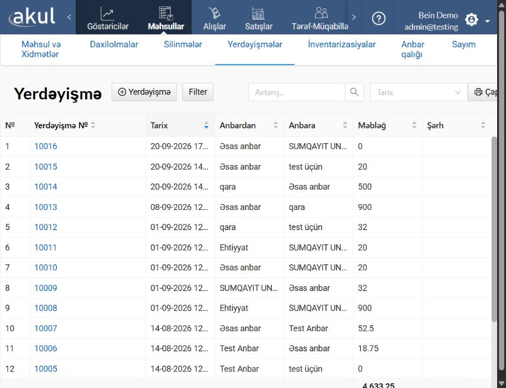
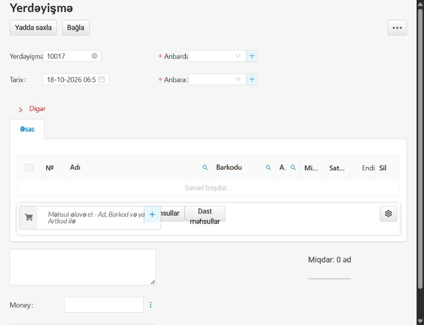

# Məhsulun anbarlar arasında yerdəyişməsi — təlimat layihəsi

Yoxlanılma tarixi: 18.10.2026 (Asia/Baku). Təlim şirkəti: Bein Demo.
Müşahidə olunan mühit: https://dev.akul.az (interfeys versiyası göstərilmirdi).
Status: naviqasiya və boş forma yoxlanılıb; yerdəyişmə əməliyyatı təsdiqlənməyib.

## İlkin şərtlər

Yalnız təlim şirkətində işləyin. Göndərən və qəbul edən anbarlar, test məhsulu
və icazələr əvvəlcədən hazırlanmalıdır. Hesabın minimum hüquqları və məlumatların
bərpası bu baxış zamanı yoxlanılmayıb. Başqa şirkət seçilməyib.

## Yoxlanılmış naviqasiya

1. **Məhsullar** bölməsində **Yerdəyişmələr** səhifəsini açın.
2. **+ Yerdəyişmə** düyməsini basın. Yeni sənədin boş forması açılır.
3. Formanı dəyişmədən bağlamaq üçün **Bağla** düyməsini basın.

## Formada görünən sahələr

- **Anbardan** — məhsulun göndərildiyi anbar üçün seçim sahəsi.
- **Anbara** — məhsulun qəbul edildiyi anbar üçün seçim sahəsi.
- **Məhsul əlavə et — Ad, Barkod və ya Artkod ilə** — məhsul seçimi.
- **Miqdar** — məhsul cədvəlində miqdar sütunu.
- **Tarix**, **Yerdəyişmə №** və şərh sahəsi.

Bu pilotda anbar və məhsul seçilməyib, miqdar daxil edilməyib. **Yadda saxla**
düyməsi basılmayıb; boş formada o, qeyri-aktiv idi. Sənədin saxlanılması,
keçirilməsi və anbar qalıqlarının dəyişməsi yoxlanılmayıb. Buna görə bu material
hazır, tam yoxlanılmış əməliyyat təlimatı kimi yayımlanmamalıdır.

## Növbəti yoxlama

Məsul əməkdaş demo hesabının hüquqlarını və bərpa üsulunu təsdiqlədikdən sonra,
ayrıca icazə ilə test anbarları və məhsul üzrə doldurma/saxlama yoxlanılmalıdır.
Saxlamanın nəticəsi və hər iki anbardakı qalıqlar ayrıca təsdiqlənməlidir.
Knowledge Sources-a nəşr yalnız əməkdaşın yoxlamasından və təsdiqindən sonra mümkündür.
